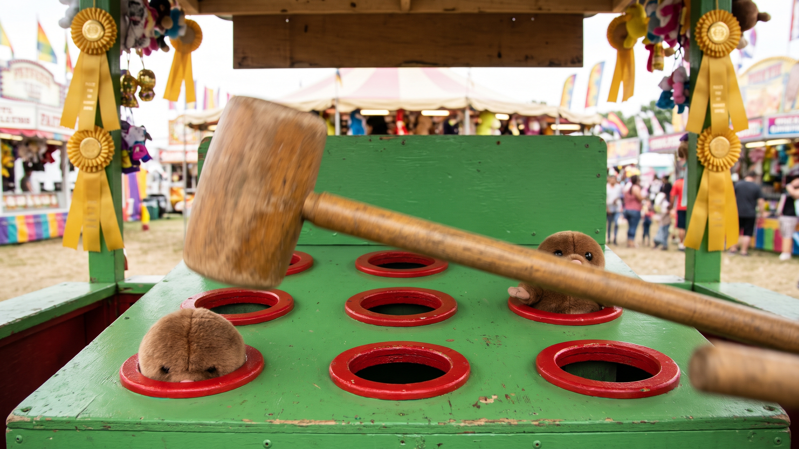
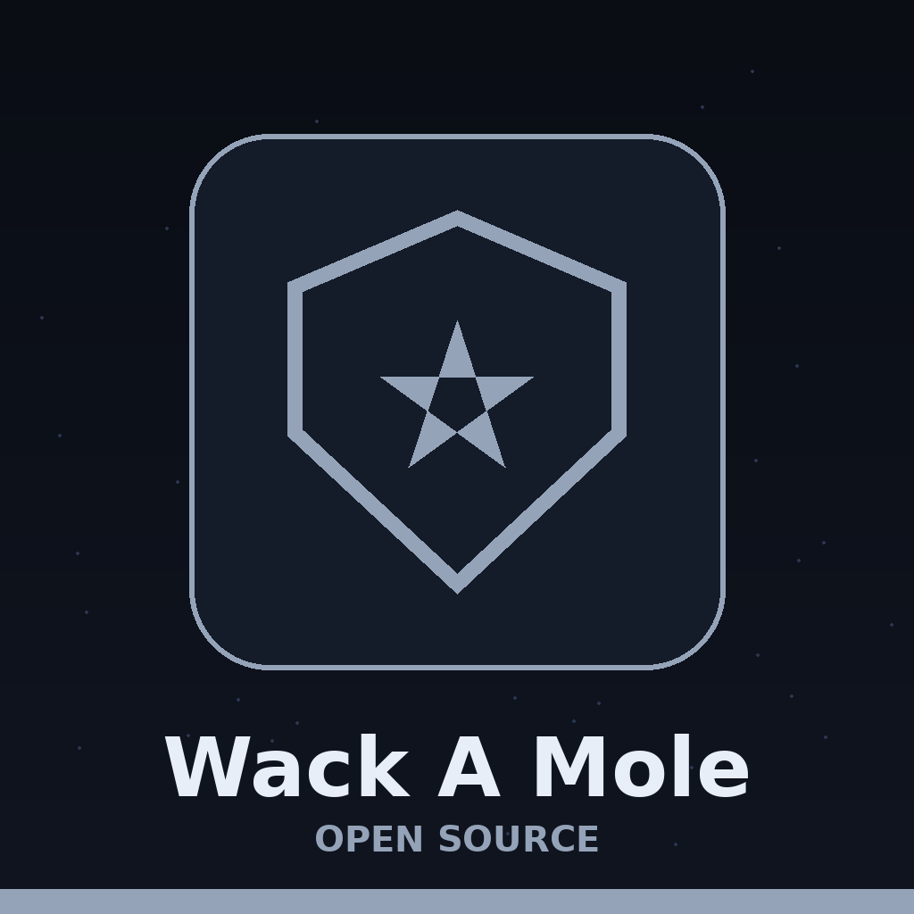
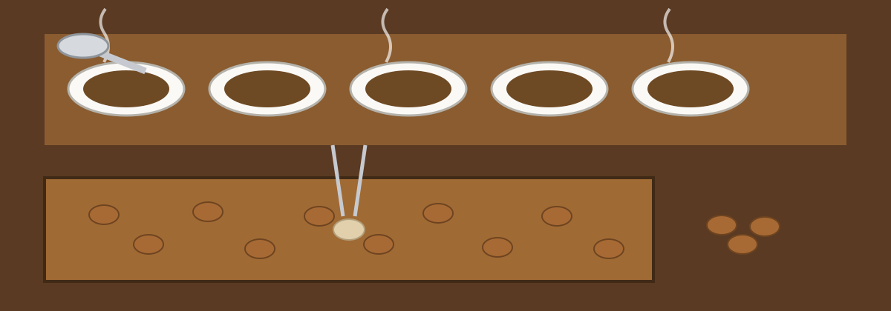

# Wack-A-Mole

A single-file whack-a-mole game: open `Wack.html` in a browser and play.
Nine holes, 30 seconds, one point per whack; the pace of the moles is
random, between half a second and a second and a half up at a time.

> The animal shown is a hedgehog, chosen because it reads well at that size, while the class name in the code stayed mole. Scripted clicks are refused, because the game checks that each click came from a real press.

The high score board is optional. The page looks for Firebase
configuration supplied by its hosting environment (`__firebase_config`
and friends); when none is present, which is the case for the plain file
served on its own, the game runs the same but scores are not saved
anywhere.

> The score board is conditional. Scores are saved only when Firebase configuration, sign in, and the database are all present, and only the best score per player is kept.
